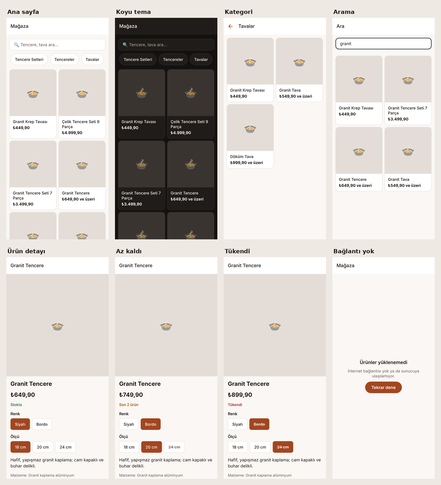

# Mağaza

Ürün satışı, kampanyalar ve müşteri hesabı olan mobil e-ticaret uygulaması.
iOS ve Android için tek kod tabanı (Expo); ürün, sipariş ve kampanyalar yönetim panelinden yönetilir (Medusa).

> Durum: **v0.2.0 — katalog.** Yol haritası: [docs/mimari.md](docs/mimari.md#yol-haritası).

## Vitrin


## Yapı
```
magaza/
├── apps/mobile/     Expo (React Native) uygulaması — iOS + Android
├── apps/backend/    Medusa sunucusu + yönetim paneli (ürün, sepet, sipariş, kampanya, müşteri)
├── docs/            mimari ve kararlar
├── scripts/         ortak betikler (bağımlılık denetimi)
└── docker-compose.yml  yerel PostgreSQL
```

## Gereksinimler
- Node.js 22.22 veya üstü (LTS önerilir), npm
- Docker (yerel veritabanı için) ya da PostgreSQL 15+
- Telefonda deneme: development build (bkz. [Expo standardı](https://docs.expo.dev/develop/development-builds/introduction/))

## Kurulum ve çalıştırma
```bash
# 1. Veritabanı
docker compose up -d

# 2. Sunucu
cd apps/backend
cp .env.example .env        # DATABASE_URL ve CORS değerlerini doldurun (dosyadaki açıklamalara bakın)
npm ci
npx medusa db:migrate       # tablolar + Türkiye bölgesi + örnek ürünler
npx medusa user -e <e-posta> -p <şifre>   # yönetim paneli kullanıcısı
npm run dev                 # http://localhost:9000/app

# 3. Mobil uygulama (yeni terminal)
cd apps/mobile
cp .env.example .env        # sunucu adresi + yönetim panelindeki yayımlanabilir anahtar (pk_…)
npm ci
npx expo start
```

## Test ve kontroller
| | Mobil (`apps/mobile`) | Sunucu (`apps/backend`) |
|---|---|---|
| Hepsi | `npm run check` | `npm run check` |
| Lint · tip | `npx expo lint` · `npx tsc --noEmit` | `npm run lint` · `npm run typecheck` |
| Test | `npx jest` | `npm run test:unit` · `npm run test:integration:http` |
| Bağımlılık denetimi | `node ../../scripts/denetim.mjs` | `node ../../scripts/denetim.mjs` |

CI her push'ta ilgili uygulamanın kontrollerini ve gizli bilgi taramasını (gitleaks) çalıştırır.

## Ortam değişkenleri
Her uygulamanın `.env.example` dosyası tüm adları ve açıklamaları içerir. `.env` repoya girmez.
Mobil uygulamadaki `EXPO_PUBLIC_` değerleri uygulama paketine gömülür: oraya **hiçbir sır yazılmaz**.

## Bilinen eksikler
- Sepet, hesap ve ödeme henüz yok (yol haritası 2–4. aşamalar); ürün detayında sepete ekleme 2. aşamada gelir.
- Örnek ürünlerin görseli yok (yer tutucu gösterilir); gerçek fotoğraflar yönetim panelinden eklenir.
- Görsel tasarım temel tema düzeyinde; marka yönü seçimi bekliyor.
- Uygulama web'i hedeflemez (`expo-secure-store` web'de yoktur).
- Yerel geliştirme Redis'siz çalışır (olay yolu bellekte); canlıda Redis gerekir.

## Lisans
Tüm hakları saklıdır. Başlangıç şablonlarının lisansları: [NOTICE.md](NOTICE.md).
